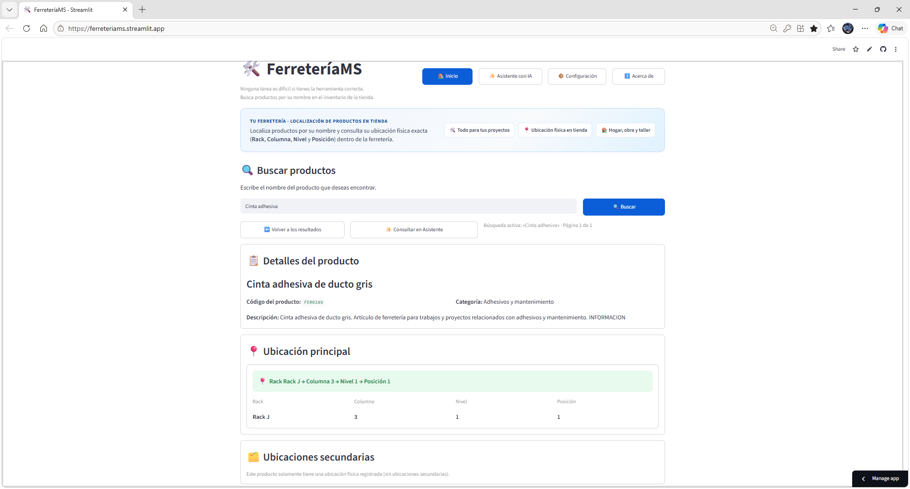
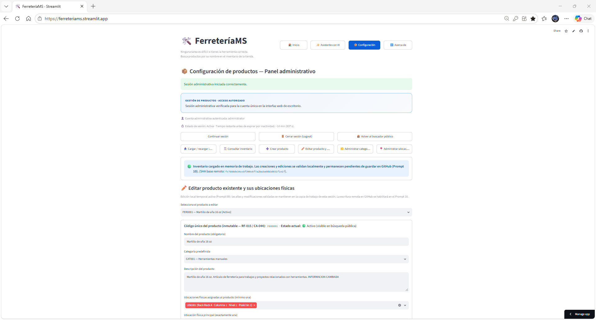
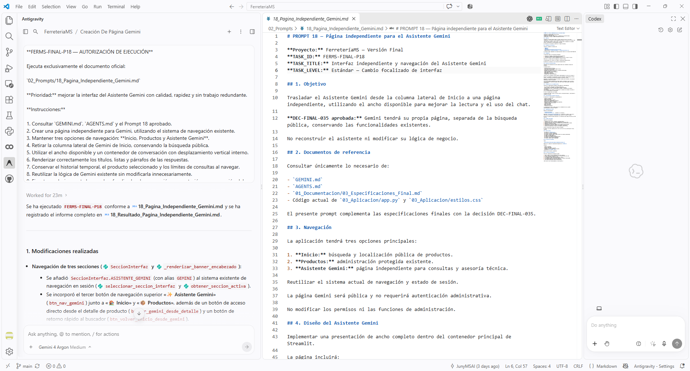
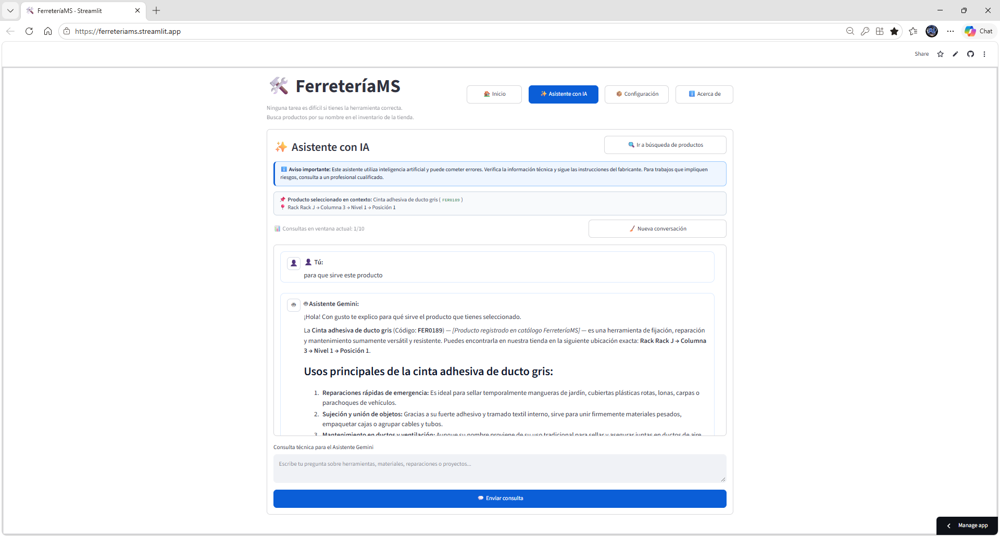
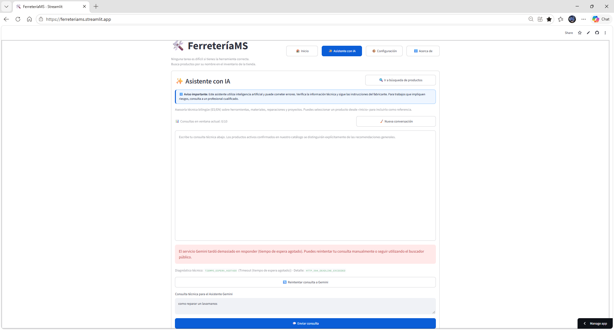

# FerreteríaMS
**Enlace a la app:** https://ferreteriams.streamlit.app/  
**Enlace al repositorio:** https://github.com/JunyMSAI/FerreteriaMS.git

**Autor/a:** Concepción Morales Surén

## Pitch
1. En una ferretería, encontrar un artículo, saber exactamente dónde está ubicado y saber cómo se usa el artículo de forma correcta puede consumir mucho tiempo.
2. El problema normalmente lo tienen clientes no especializados, que les gusta resolver y arreglar las cosas en su casa, patio y oficina por cuenta propia.
3. La aplicación brindara la localización o ubicación del producto o accesorios de forma rápida en los (rack o estantería) dentro de la tienda usando el inventario de la ferretería. 
4. La IA proveerá información técnica, modo de uso, medidas de seguridad y almacenamiento del producto o accesorios.
5. La IA brindara asesoría interactiva con recomendaciones de accesorios (ej. arandelas/tuercas) según la necesidad del cliente, cuando este le explique a la inteligencia artificial cual es la tarea o proyecto que este realizando.
6. El mayor aprendizaje fuel el poder entender el propósito que tiene los diferentes componentes o archivos dentro de una aplicación creada con inteligencia artificial y poder crear un proceso mental, bien organizado y estructurado de como trabajar y desarrollar con una inteligencia artificial.
7. Lo que me gustaría hacer después es darle la capacidad a la aplicación de poder procesar y trabajar con imágenes ya que en esta etapa solo fue texto y poder incorporar un modelo de inteligencia artificial creado por mí y que corra localmente en una máquina. 

## El problema
1. Los clientes no especializados que van a tiendas de ferretería pierden mucho tiempo buscando la ubicación exacta de los productos en los estantes o rack en una ferretería y mucho más cuando no están seguros de que deben comprar para resolver su problema.
2. La mayoría de los clientes carecen de asesoría técnica inmediata para seleccionar las herramientas y accesorios adecuados para sus proyectos, tarea o problema que quieren arreglar en la casa, patio u oficina.
3. La forma en que se resuelve hoy es usando al mismo personal de la ferretería para que te ayude a buscar lo que quieres y en muchos casos al ellos no conocer del tema termina vendiéndote cualquier cosa, sin darte una buena orientación.
4. Merece la pena resolverlo porque siempre he creído que cuando una persona está bien orientada toma buenas decisiones, ahorrándose tiempo, dinero y retrabajo, que tan solo con una buena orientación esto se evitaría.   

## Qué hace la app
1. **Buscar un producto:** entra a la **Pantalla de Inicio**, escribe el nombre del producto que estas buscando y la aplicación normaliza acentos y mayúsculas y organiza los resultados por relevancia.
2. **Conocer sus detalles:** selecciona un producto para ver su descripción, categoría y ubicación principal (rack, columna, nivel y posición), así como ubicaciones adicionales cuando existan.
3. **Consultar al asistente:** entra a la **Pantalla de Asistente con IA** y pregunta en español o inglés sobre la herramienta, materiales, reparaciones o proyectos. Según lo que le pregunte la aplicación va asesorandote en cómo puedo hacer las cosas ya sea con productos de la tienda o fuera de la tienda.
4. **Administrar el catálogo:** mediante la **Pantalla de Configuración** y después de autenticarse, **Usuario de prueba "administrator" y contraseña "admin"**. puedes modificar productos, categorías y ubicaciones; también activar o desactivar productos sin borrar sus registros.
5. **Guardar los cambios:** la aplicación trabaja con un inventario Excel de cuatro hojas y utiliza GitHub para leer el archivo y mediante el flujo administrativo autorizado, registrar cambios validados.
6. **Consultar información general:** la página **Acerca de** explica el propósito, las funciones y el uso de FerreteríaMS.
7. La consulta pública no requiere una cuenta administrativa. La ubicación mostrada corresponde al registro del inventario.

## La pieza de IA
1. **Qué usa:** la **API de Google Gemini**, integrada en Python mediante `google-genai`; se utilizó el modelo `gemini-3.5-flash-lite`.
2. **Por qué esa opción:** elegi la API de Gemini porque ofrece capacidades de razonamiento conversacional y generación de recomendaciones contextuales personalizadas.
3. **Qué pasa si falla:** el buscador continúa funcionando, aunque la API de Gemini falle, no esté disponible o se alcance una cuota. El asistente muestra un aviso controlado y permite identificar la categoría del fallo sin exponer la clave API. La aplicación también establece límites de consultas por sesión.

## Cómo la he construido
1. **Herramientas:** 
	- utilicé mi agente de ChatGPT como mi consultor de software y aplicaciones, definiendo y consultando todo lo relacionado al concepto, especificaciones, prompt y estrategias de implementación, una vez que estuviera convencido de lo que se iba a hacer, se procedía a realizar la documentación para revisarla y una vez yo la aprobaba entonces se utilizaba y se la pasaba al agente Antigravity en VS code para que la ejecutara.
	- utilicé VS Code para organizar el proyecto y trabajar el desarrollo de la aplicación por etapas, de forma local y sincronizado con mi repositorio de Github.
	- utilicé el agente Atigravity (Gemini) como programador del software de la aplicación, una vez terminaba el desarrollo y las pruebas internas yo procedía a probar la aplicación y confirmar que estaba todo bien. 
	- utilicé las librerías o paquetes de Python: Streamlit 1.30.0, pandas 2.0.0, openpyxl 3.1.0, argon2-cffi 23.1.0 y google-genai 1.0.0 para la aplicación.
	- utilicé Git y GitHub para versionado y repositorio para guardar el proyecto e inventario;
	- utilicé Streamlit Community Cloud para el despliegue de pruebas y de la aplicación.	

2. **Fichero de contexto del agente:** 
	- [GEMINI.md](./GEMINI.md)	
	- [AGENTS.md](./AGENTS.md) 
	- Las especificaciones por etapas:
		> [02_Especificaciones_v0.md](./01_Documentacion/02_Especificaciones_v0.md)

		> [03_Especificaciones_Final.md](./01_Documentacion/03_Especificaciones_Final.md)

	- El índice de Prompts:
		> [04_Definicion_de_Prompts.md](./01_Documentacion/04_Definicion_de_Prompts.md)		

3. **Prompts clave:** seleccioné tres prompts oficiales relevantes para mostrar cómo guie al agente.

	- **P04 — Búsqueda pública:** [04_Busqueda_Publica.md](./02_Prompts/04_Busqueda_Publica.md),
    Construir la búsqueda de productos por nombre con coincidencias parciales, normalización de texto, relevancia y pagina en Streamlit.
  
	- **P16 — Integración funcional de Gemini:** [16_Integracion_Gemini.md](./02_Prompts/16_Integracion_Gemini.md),
    Desarrollar el asistente de texto para asesoría de ferretería, con contexto del inventario, restricciones temáticas, advertencias y límites de consumo.
	
	- **P18 — Página independiente de Gemini:** [18_Pagina_Independiente_Gemini.md](./02_Prompts/18_Pagina_Independiente_Gemini.md),
    Separar el chat de la búsqueda pública y trasladarlo a una sección propia.
	
4. **Qué delegué al agente y qué revisé a mano:** 
	- Delegué a Antigravity la creación y modificación del código conforme a los prompts aprobados, la preparación de pruebas y la elaboración de informes técnicos, siguiendo las instrucciones y prompts que desarrollé junto a mi asistente ChatGPT.
	- Yo definí el concepto, escogí una arquitectura con Excel, pandas, Streamlit y GitHub, revisé pantallas, probé la aplicación publicada, identifiqué errores, decidí qué cambios aceptar y autoricé los commits y despliegues, decidí la organización base del repositorio y como estaría estructurado y organizado todo el repositorio y la aplicación. Modifique codigo para acomodar botones y descripciones.
	- Por ejemplo, detecté que la primera presentación del chat ocupaba una columna demasiado estrecha, que Gemini devolvía daba un error de modelo no disponible. Solicité correcciones concretas, conservando las partes de la aplicación que ya funcionaban.

## Prueba y mejora
1. Prueba de la pantalla de Inicio.
	- Quién la probó: Yo, como usuario
	- Qué probó: Buscar artículos y consultar su ubicación.
	- Qué pasó: La búsqueda pública y la consulta del catálogo funcionaron durante las pruebas realizadas.
	- Qué cambié: Continué mejorando detalles, navegación e inventario de evaluación.
	
2. Consultas al modelo de IA.
	- Quién la probó: Yo, usando el asistente.
	- Qué probó: Consultas reales sobre herramientas y reparaciones.
	- Qué pasó: Gemini devolvía inicialmente `HTTP 404 NOT_FOUND` para el modelo elegido.
	- Qué cambié: Solicité actualizar el modelo buscando uno compatible y verifiqué después que el asistente respondía.
	
3. Respuesta extensa del modelo de IA.
	- Quién la probó: Yo, usando el asistente.
	- Qué probó: Lectura de una respuesta extensa.
	- Qué pasó: El texto crecía hacia abajo dentro de una columna demasiado estrecha.
	- Qué cambié: Trasladé el asistente a una página independiente.

## Capturas

**1. Aplicación funcionando — Inicio y búsqueda pública**  

**2. Aplicación funcionando — Configuración del inventario**  

**4. Trabajo con IA — Agente de desarrollo creando la página independiente del asistente**  

**5. Prueba — Consulta el asistente en su página independiente**  

**6. Caso límite — Error controlado de la API**  
